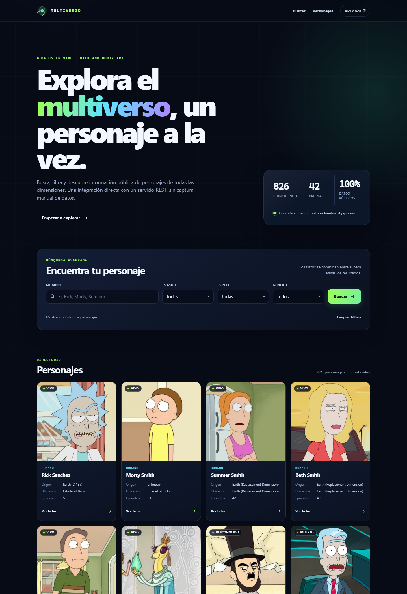
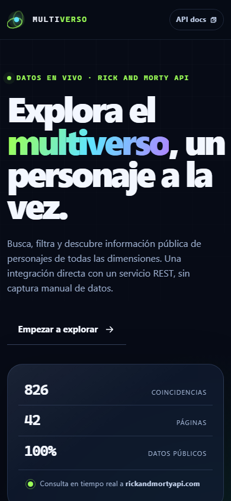

# Multiverso · Explorador de personajes

Aplicación web que consume la API REST pública **The Rick and Morty API** para buscar, filtrar, paginar y consultar información de personajes en tiempo real.

Este proyecto moderniza la Unidad 4: sustituye la práctica centrada únicamente en XML por una integración web basada en **JSON**, **Fetch API**, **async/await** y manipulación dinámica del DOM.

[](https://emirang.github.io/Practica4.0-PrograWeb/)


## Vista previa



<p align="center">
    
</p>

## Objetivo de aprendizaje

Integrar una aplicación web con un servicio externo mediante una API REST, utilizando JSON, Fetch API y programación asíncrona para obtener, procesar y presentar información.

## Funcionalidades

- **Búsqueda por nombre** de personaje.
- **Filtros combinables** por estado, especie y género.
- **Paginación** con navegación anterior/siguiente.
- **Ficha de detalle** en un diálogo modal con información ampliada.
- **Estado de carga** con tarjetas esqueleto.
- **Estado vacío** cuando no existen coincidencias.
- **Manejo de errores** de red, HTTP y respuestas inválidas, con opción de reintentar.
- **URL compartible**: los filtros y la página se reflejan en la barra de direcciones.
- **Cancelación de solicitudes anteriores** con `AbortController` cuando el usuario realiza otra búsqueda.
- **Diseño responsivo** para escritorio, tableta y móvil.
- **Accesibilidad**: navegación por teclado, etiquetas, foco visible, regiones `aria-live` y movimiento reducido.
- **Imagen de respaldo** si una fotografía de la API no está disponible.

## API utilizada

| Dato | Valor |
|---|---|
| Servicio | [The Rick and Morty API](https://rickandmortyapi.com/) |
| Documentación | <https://rickandmortyapi.com/documentation> |
| URL base | `https://rickandmortyapi.com/api` |
| Endpoint principal | `GET /character` |
| Formato | JSON |
| Autenticación | No requiere clave ni datos sensibles |
| CORS | Habilitado (`Access-Control-Allow-Origin: *`) |

### Parámetros utilizados

| Parámetro | Tipo | Descripción | Ejemplo |
|---|---|---|---|
| `page` | entero | Número de página de resultados. | `page=2` |
| `name` | texto | Filtra por nombre del personaje. | `name=rick` |
| `status` | texto | Estado: `alive`, `dead` o `unknown`. | `status=alive` |
| `species` | texto | Especie del personaje. | `species=Human` |
| `gender` | texto | Género: `female`, `male`, `genderless` o `unknown`. | `gender=female` |

Ejemplo de consulta:

```text
https://rickandmortyapi.com/api/character/?name=morty&status=alive&page=1
```

### Formato de respuesta

```json
{
  "info": {
    "count": 34,
    "pages": 2,
    "next": "https://rickandmortyapi.com/api/character/?page=2&name=morty&status=alive",
    "prev": null
  },
  "results": [
    {
      "id": 2,
      "name": "Morty Smith",
      "status": "Alive",
      "species": "Human",
      "gender": "Male",
      "origin": { "name": "unknown" },
      "location": { "name": "Citadel of Ricks" },
      "image": "https://rickandmortyapi.com/api/character/avatar/2.jpeg",
      "episode": ["https://rickandmortyapi.com/api/episode/1"],
      "url": "https://rickandmortyapi.com/api/character/2",
      "created": "2017-11-04T18:48:46.250Z"
    }
  ]
}
```

### Códigos y errores considerados

| Situación | Tratamiento en la aplicación |
|---|---|
| `200 OK` | Se procesa el JSON y se renderizan las tarjetas. |
| `404 Not Found` | La API devuelve `{"error":"There is nothing here"}`. Se muestra el estado vacío, no un error técnico. |
| `429 Too Many Requests` | Se informa que se alcanzó temporalmente el límite de consultas. |
| `5xx` | Se muestra un mensaje comprensible y un botón para reintentar. |
| Error de red / CORS | Se indica que no fue posible conectar con el servicio. |
| JSON con formato inesperado | Se detiene el procesamiento y se muestra el estado de error. |

## Tecnologías

- HTML5 semántico.
- CSS3 con Grid, Flexbox, variables, gradientes y animaciones.
- JavaScript moderno (ES2020+).
- `fetch()` con `async/await`, `AbortController` y `URLSearchParams`.
- API REST pública en formato JSON.
- Git y GitHub.
- GitHub Pages para el despliegue.

No se utilizan frameworks, dependencias de ejecución ni proceso de compilación. La aplicación es completamente estática.

## Estructura del proyecto

```text
Practica#4/
├── index.html              # Estructura de la aplicación
├── css/
│   └── styles.css          # Diseño responsivo y componentes visuales
├── js/
│   └── app.js              # Consumo de la API, estado e interacción
├── assets/
│   ├── favicon.svg         # Icono del sitio
│   └── placeholder.svg     # Imagen de respaldo
├── docs/
│   ├── preview.png         # Captura de escritorio
│   ├── preview-mobile.png  # Captura móvil
│   └── preview-dialog.png  # Captura de la ficha de detalle
├── legacy/
│   └── xml/                # Práctica anterior de XML conservada como archivo
├── README.md
└── .gitignore
```

## Cómo ejecutar en local

La aplicación necesita abrirse desde un servidor HTTP para que las rutas relativas y las solicitudes a la API funcionen correctamente en todos los navegadores.

### Opción 1: Python

```bash
python -m http.server 8000
```

Después abre:

```text
http://localhost:8000
```

### Opción 2: VS Code

Instala la extensión **Live Server**, abre `index.html` y selecciona **Open with Live Server**.

No se necesita instalar paquetes ni configurar variables de entorno.

## Despliegue

El proyecto está preparado para GitHub Pages porque no requiere backend ni compilación.

1. Subir el contenido de la rama `main` al repositorio.
2. En GitHub, entrar a **Settings → Pages**.
3. Seleccionar **Deploy from a branch**.
4. Elegir la rama `main` y la carpeta `/ (root)`.
5. Guardar y esperar a que GitHub publique el sitio.

URL esperada:

```text
https://emirang.github.io/Practica4.0-PrograWeb/
```

## Correspondencia con la actividad

| Instrucción | Implementación |
|---|---|
| 1. API pública sin datos sensibles | The Rick and Morty API, sin autenticación. |
| 2. Documentación, endpoint, parámetros y errores | Sección [API utilizada](#api-utilizada) de este README y manejo de códigos en `app.js`. |
| 3. Consumir con `fetch()` y `async/await` | Función `loadCharacters()` en `js/app.js`. |
| 4. Procesar JSON y crear componentes dinámicos | `renderCharacters()`, `createCharacterCard()` y `openCharacterDialog()`. |
| 5. Interacción del usuario | Búsqueda, filtros combinables, paginación y ficha modal. |
| 6. Estados de carga, vacío y error | `showLoading()`, `showEmptyState()` y `showErrorState()`, con mensajes comprensibles. |
| 7. Registro en Git y publicación en GitHub | Repositorio con commits descriptivos y publicación en GitHub. |
| 8. Despliegue y comprobación | Publicación estática mediante GitHub Pages. |

## Flujo de una consulta

1. El usuario escribe un nombre o selecciona filtros y envía el formulario.
2. Se actualiza el estado interno y la URL.
3. Se cancela cualquier solicitud anterior que siga en curso.
4. Se muestra el estado de carga con tarjetas esqueleto.
5. `fetch()` consulta el endpoint con `URLSearchParams`.
6. Si la respuesta es correcta, se transforma el JSON en tarjetas del DOM.
7. Si no hay coincidencias, se muestra un estado vacío.
8. Si ocurre un fallo, se muestra un mensaje claro y la opción de reintentar.

## Autor

**Emir Ang**  
Proyecto académico de Programación Web · FIME · 2026

## Créditos

- Datos: [The Rick and Morty API](https://rickandmortyapi.com/).
- Rick and Morty es una marca de sus respectivos propietarios. Este proyecto es académico y no está afiliado al servicio ni a la franquicia.
